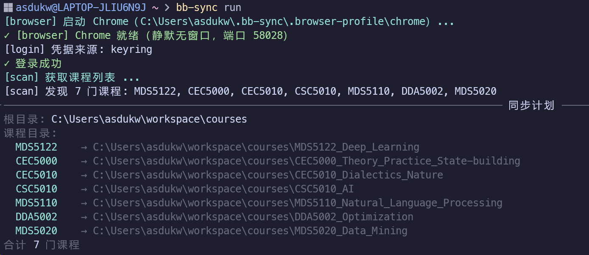
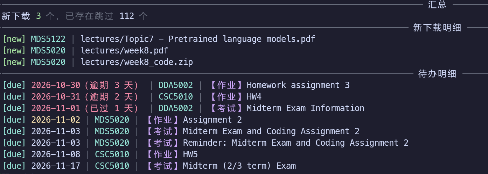

# bb-sync

**港中深（香港中文大学·深圳 / CUHK-Shenzhen / CUHKSZ）Blackboard 课件下载与课程资源自动同步 CLI**

登录 `bb.cuhk.edu.cn`，把课件、作业和指导 / 实验（tutorial / lab）增量下载到本地，把公告和全部课程的待办整理成 Markdown。重复运行时会跳过已经下载的文件。

*Blackboard course material sync CLI for CUHK-Shenzhen students.*

[](https://github.com/asdukw/cuhk-shenzhen-blackboard-sync/actions/workflows/ci.yml)
[](https://github.com/asdukw/cuhk-shenzhen-blackboard-sync/releases)
[](pyproject.toml)
[](LICENSE)
[](#安装)

> **适用边界**：只适配香港中文大学（深圳）的 `bb.cuhk.edu.cn` 和它的 ADFS SSO 登录流程。
> 其他学校、其他 Blackboard 站点请勿安装。支持 Windows 10/11（PowerShell）与 macOS（Intel / Apple Silicon，zsh / bash）。

## 它解决什么问题

Blackboard 上的东西散在「课程内容」「作业」「公告」几个入口，一学期下来几十上百个文件，靠手动点、手动记截止日期很容易漏。bb-sync 把这些收进本地一个目录：

- 课件、作业、指导按课程归好类，重跑只下新增的，结束时逐条列出本轮真正新下载的文件；
- 有公告的课程会生成一份 `announcements.md`（没有公告的课程不生成，`bb-sync due` 也不写这个文件）；
- 全部课程的待办汇总成一份 `due.md`，按「已逾期 → 今天 → 明天 → 未来 7 天 → 之后 → 日期未知 → 已过期事件（仅供回看）」排好序，公告里带日期的课堂测验、考试和作业截止时间也一并计入；每条待办都是可勾选的任务列表（`- [ ]`），做完勾上 `- [x]`，下次同步会保留完成状态。

它**不做**这些：不回传作业、不代签到、不抓成绩、不绕过任何权限——看到的就是你账号里本来能看到的。

## 长什么样

`bb-sync run` 的真实输出：启动后台浏览器、登录、列课，然后先打印一份「同步计划」——每个课程代码会落到哪个本地目录，动手前就能确认：



跑完后是汇总：这轮新下载了什么、跳过了多少已存在的文件；最后是逐条待办明细，逾期红色、测验 / 考试带类型标签：



下面的文本示例用于复制（课程名和文件名为虚构，链接缩写为 `…`，实际每条都带回到对应 Blackboard 课程页的链接）。

`due.md`：

````markdown
# Blackboard 待办

> 更新时间：2026-10-14 21:03（本地时间）
> 已检查 5 门课程，发现 7 项待办；按优先级和截止日期排列。
> 其中公告里的测验 1 项、考试 1 项、作业 1 项已一并作为待办列出。
> 另有 1 项公告里的测验/考试日期已过，列在最后仅供回看。
> 完成一项就在前面打勾（`- [ ]` → `- [x]`），下次同步会保留完成状态。

## 已逾期（1）

- [ ] **2026-10-12**（逾期 2 天） — [CSC5010](https://bb.cuhk.edu.cn/…) — 作业 3 实验报告

## 今天（1）

- [ ] **2026-10-14**（今天） — [MAT1001](https://bb.cuhk.edu.cn/…) — 习题 5

## 明天（1）

- [ ] **2026-10-15**（明天） — [CSC5010](https://bb.cuhk.edu.cn/…) — 【测验】Quiz 2

## 未来 7 天（3）

- [x] **2026-10-17**（还有 3 天） — [ENG1001](https://bb.cuhk.edu.cn/…) — Essay 1 初稿
- [ ] **2026-10-20**（还有 6 天） — [CSC5010](https://bb.cuhk.edu.cn/…) — 【作业】HW4
- [ ] **2026-10-21**（还有 7 天） — [MAT1001](https://bb.cuhk.edu.cn/…) — 【考试】期中考试

## 已过期事件（1）

- [ ] **2026-10-08**（已过 6 天） — [CSC5010](https://bb.cuhk.edu.cn/…) — 【测验】Quiz 1
````

下载目录：

```text
~/courses/
├── CSC5010_人工智能/
│   ├── lectures/
│   │   ├── 01 绪论.pdf
│   │   └── 02 搜索算法.pdf
│   ├── assignments/
│   │   └── hw1/
│   │       ├── hw1.pdf
│   │       └── starter.zip
│   ├── tutorials/
│   │   └── tutorial01.ipynb
│   └── announcements.md
├── MAT1001_微积分/
│   └── ...
└── due.md
```

## 安装

需要 uv、Git 和 Chrome 或 Edge。uv 会自动准备兼容的 Python 3.11+ 并隔离安装，不需要预先安装 Python；浏览器会自动探测常见安装位置，Windows 自带的 Edge 直接可用。

### Windows

在 PowerShell 中执行：

```powershell
winget install --id Git.Git -e
powershell -ExecutionPolicy ByPass -c "irm https://astral.sh/uv/install.ps1 | iex"
```

也可以自行安装 Google Chrome。

### macOS

推荐先安装 [Homebrew](https://brew.sh/)，再执行：

```bash
brew install git uv
brew install --cask google-chrome
```

如果已经安装 Chrome 或 Edge，可跳过最后一条。Edge 的 cask 名称为 `microsoft-edge`。

### 安装 bb-sync（Windows / macOS 相同）

**重开终端**后执行：

```bash
uv tool install bb-sync
bb-sync doctor
```

也可以直接从 GitHub 安装（跟随 `main` 上的最新代码）：

```bash
uv tool install git+https://github.com/asdukw/cuhk-shenzhen-blackboard-sync
```

`bb-sync doctor` 用于检查环境；刚安装时凭据显示“未配置”、浏览器后端显示“未运行”都是正常的。如果提示找不到 `bb-sync`，执行 `uv tool update-shell` 后重开终端。

## 首次使用

保存学号和密码：

```bash
bb-sync auth login
```

密码会保存在 Windows 凭据管理器或 macOS 钥匙串，不会写入配置文件。macOS 首次访问时可能弹出钥匙串授权提示，选择允许即可。

第一次同步如果想看到登录过程（或手动完成验证码），可以用有头模式：

```bash
bb-sync run --headed
```

这条命令会用你机器上的 Chrome（没有则用 Edge）打开一个窗口，登录一次即可。之后同步直接运行：

```bash
bb-sync run
```

浏览器默认在**后台无窗口**运行，**跑完自动关闭**，不会在你机器上留下进程。登录态存在 `~/.bb-sync/.browser-profile/` 下、跨次运行保留，所以不必每次登录。

想让窗口在命令结束后留在屏幕上（例如连续跑几条命令、观察页面），用 `--headed --keep-open`；之后再 `bb-sync browser stop` 关闭。

## 文件位置

默认下载到用户主目录下的 `courses`：

- Windows：`C:\Users\<你>\courses`
- macOS：`/Users/<你>/courses`

每门课一个文件夹：

- 课件 → `lectures/`
- 作业 → `assignments/`
- 指导 / 实验（tutorial / lab） → `tutorials/`
- 公告 → `announcements.md`（没有公告的课程不会生成）

课程根目录还会生成 `due.md`：

- 按「已逾期 → 今天 → 明天 → 未来 7 天 → 之后 → 日期未知 → 已过期事件」排序；公告里带日期的课堂测验、考试和作业截止时间也计入；
- 每条待办带 `- [ ]` 复选框，勾选状态跨次同步保留；考完的测验 / 考试归入最后的「已过期事件」，保留 7 天；
- 「更新时间」只在待办内容变化时刷新；内容没变时不重写，没有待办时显示 Congratulations。

要修改下载目录：

```bash
bb-sync config set root "~/University/courses"
```

Windows 也可以使用 `bb-sync config set root "D:/University/courses"`。更完整的配置说明见 [docs/config.md](docs/config.md)。

## 常用命令

| 命令 | 作用 |
| --- | --- |
| `bb-sync run` | 增量同步全部课程并更新 `due.md` |
| `bb-sync run --headed` | 显示浏览器，适合首次登录或观察登录过程 |
| `bb-sync run --course CSC5010` | 只同步指定课程，可重复使用（`due.md` 也只保留这些课程） |
| `bb-sync run --dry-run` | 预览下载和待办，不写文件 |
| `bb-sync run --root <目录>` | 本次同步到指定目录（临时覆盖配置里的 `root`） |
| `bb-sync run --keep-open` | 跑完保留浏览器（配合 `--headed` 才能看到窗口；连着跑多条命令） |
| `bb-sync due` | 扫描全部课程的 Due / To Do 与公告里的测验、考试和作业 deadline，生成 `due.md` |
| `bb-sync due --course CSC5010` | 只整理指定课程的待办（`due.md` 也只保留这些课程） |
| `bb-sync due --root <目录>` | 本次把 `due.md` 写到指定目录（临时覆盖配置里的 `root`） |
| `bb-sync course list` | 列出账号下的课程 |
| `bb-sync auth login` / `logout` / `status` | 录入、删除、查看已保存的凭据 |
| `bb-sync config show` | 显示配置文件内容 |
| `bb-sync config set <键> <值>` | 修改配置；另有 `get` / `unset` / `edit` / `path` / `init` |
| `bb-sync browser status` | 查看后台浏览器是否在运行（`--keep-open` 留下的实例） |
| `bb-sync browser stop` | 关闭后台浏览器（登录态保留） |
| `bb-sync doctor` | 检查环境是否就绪（`--skip-network` 跳过网络检查） |
| `bb-sync --help` | 查看完整帮助 |

`--headed` / `--keep-open` 对 `bb-sync due` 同样适用。用 `--course` 时，`due.md` 会被整份重写为所选课程的待办，其他课程的条目不会保留。

## 遇到问题

- **`bb-sync` 找不到**：重开终端，或执行 `uv tool update-shell`。
- **连不上 Blackboard**：校外也能直接访问，不需要学校 VPN；先运行 `bb-sync doctor` 看网络那一项，多数是本机代理无法转发 HTTPS 导致的，关掉代理再试一次。
- **环境检查不通过**：按 `bb-sync doctor` 的提示安装或配置缺失项。
- **想留住浏览器窗口**：默认跑完会自动关；用 `--headed --keep-open` 才会保留可见窗口，之后用 `bb-sync browser status` 看状态、`bb-sync browser stop` 关闭（不影响登录态）。
- **登录失败**：运行 `bb-sync auth status` 查看凭据，再用 `bb-sync run --headed` 重试。
- **更换密码**：重新运行 `bb-sync auth login`。
- **换账号 / 彻底退出登录**：`bb-sync auth logout` 只删除钥匙串里的凭据，浏览器 profile 里的登录态仍然有效；先 `bb-sync browser stop`，再删除 `~/.bb-sync/.browser-profile/`。要换账号，重新运行 `bb-sync auth login` 录入新账号。

更多问题欢迎[开 Issue](https://github.com/asdukw/cuhk-shenzhen-blackboard-sync/issues)。

## 文档

- [docs/config.md](docs/config.md) —— 配置文件、目录映射与全部配置项
- [docs/scripting.md](docs/scripting.md) —— `--json` 输出结构与退出码，方便接脚本
- [CONTRIBUTING.md](CONTRIBUTING.md) —— 开发流程与质量门禁
- [CHANGELOG.md](CHANGELOG.md) —— 版本变更记录

## 免责声明

本工具只读取你自己账号里本来就能看到的内容，登录凭据保存在本机系统钥匙串中，不会上传到任何第三方。命令成功后会检查新版本（结果缓存 24 小时，每天最多请求一次 GitHub Releases API），只发送 `bb-sync/<版本号>` 作为 User-Agent，不携带任何个人信息；设置环境变量 `BB_SYNC_NO_UPDATE_CHECK=1` 可关闭该检查。

课程资料版权归香港中文大学（深圳）及各任课教师所有，**仅供个人学习使用，请勿二次分发**。使用本工具产生的一切后果由使用者自行承担。

## License

[MIT](LICENSE)
